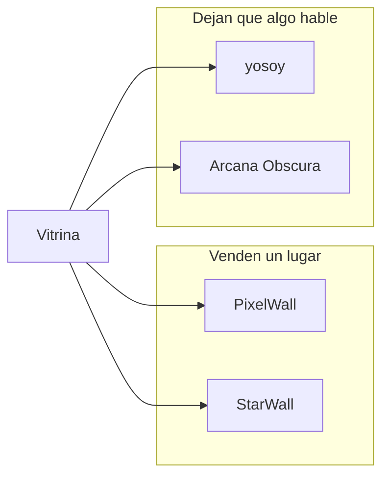
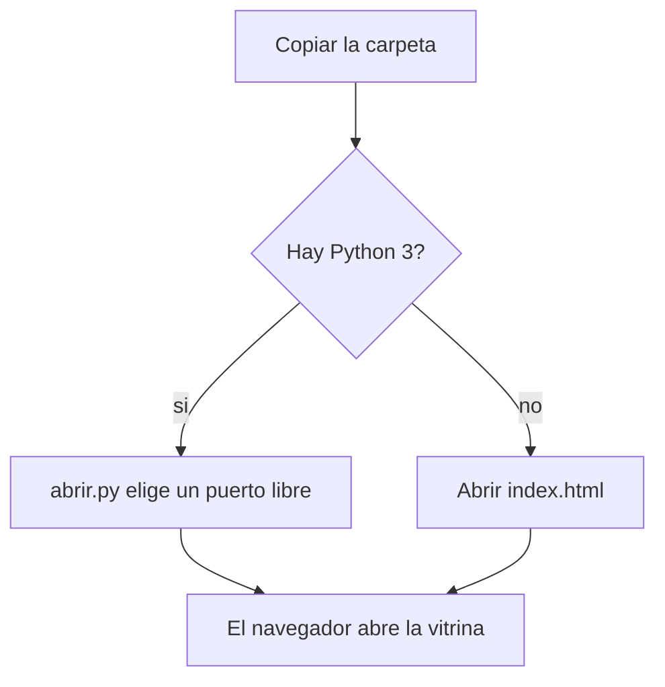
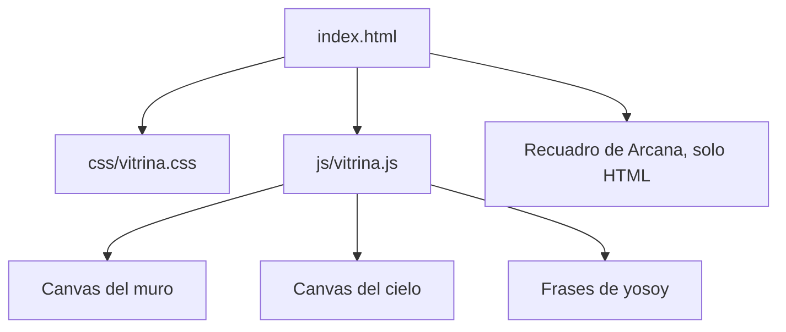
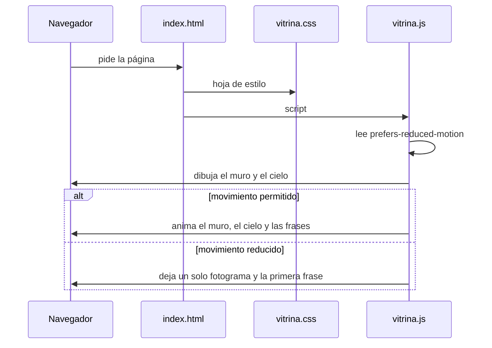
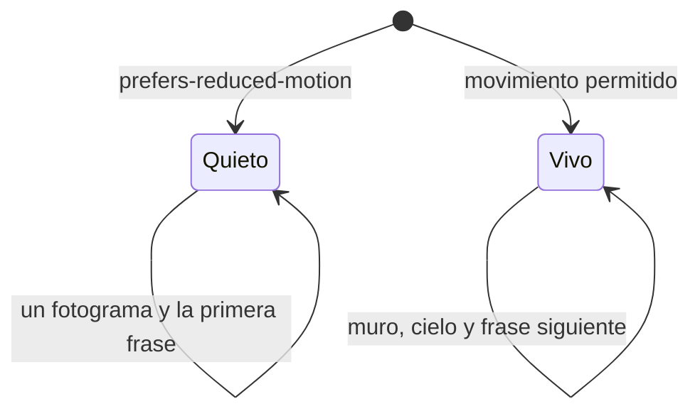
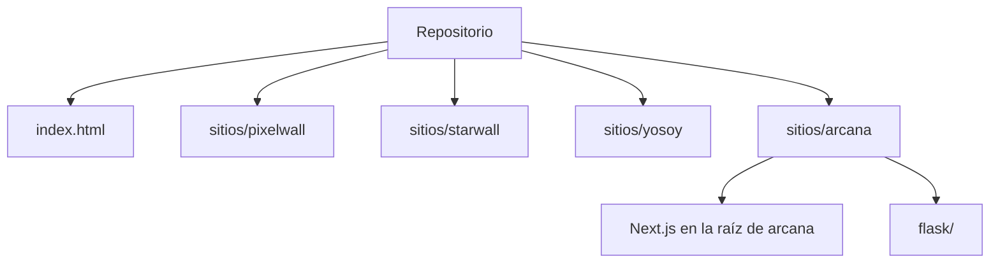

# Vitrina

Catálogo experimental de cuatro piezas. El arte y el desarrollo excéntrico van en la misma superficie: una página que no explica un producto, sino que pone juntas obras hechas con código.

PixelWall y StarWall venden un lugar. yosoy y Arcana dejan que algo te hable. La portada no ejecuta esas obras: muestra una miniatura de cada una. El código completo de las cuatro vive en `sitios/`.

La portada se abre sin instalar nada. Cada sitio trae su propio arranque, descrito más abajo.

## Orientación

La vitrina trata el desarrollo excéntrico como parte de la obra, no como un medio invisible detrás de ella.

| Pieza | Qué ocupa | Cómo está hecha la miniatura |
| --- | --- | --- |
| PixelWall | Un muro de celdas que se compra | Canvas con bloques de color sobre una grilla |
| StarWall | Una galaxia de marcas | Canvas con estrellas y dos planetas |
| yosoy | Un canal de varias conciencias | Una frase que cambia, en serif, sobre negro |
| Arcana Obscura | Un archivo que responde | Una línea y un umbral, sin animación |

Dos piezas comercian territorio. Dos piezas hablan. Las cuatro comparten la idea de una superficie pública ocupada por alguien, o por algo, que no es el visitante.



## Qué incluye y qué no

Incluye la portada y el código fuente de las cuatro piezas: plantillas, estilos, lógica y archivos de ejemplo para configurarlas en local.

No incluye dependencias descargables (`node_modules`, `venv`), bases de datos, archivos `.env` ni pagos reales. Las marcas de ejemplo son ficticias. Las contraseñas que aparecen como valor por defecto sirven solo para probar el panel en tu máquina: hay que cambiarlas antes de publicar un servidor.

## Instalación portable

Requisitos:

- Un navegador actual.
- Python 3.7 o superior, solo si quieres el servidor local. La biblioteca estándar alcanza. No hace falta `pip`.

Copia o clona la carpeta donde quieras. No hay paso de instalación.

### Con Python

Windows, en esta carpeta:

```bat
abrir.bat
```

macOS o Linux:

```sh
chmod +x abrir.sh
./abrir.sh
```

En cualquier sistema:

```sh
python abrir.py
```

El lanzador elige un puerto libre en `127.0.0.1`, sirve esta carpeta y abre el navegador. `Ctrl+C` cierra el servidor. No escribe archivos y no escucha fuera de la máquina.

### Sin Python

Abre `index.html` con doble clic. La página usa rutas relativas y no hace peticiones a un API. Las tipografías de respaldo son Georgia y una monoespaciada del sistema. Si hay red, el navegador pide Cormorant Garamond e IBM Plex Mono a Google Fonts.



## Mapa del programa

```text
.
├── index.html          Portada: cuatro fichas
├── css/vitrina.css
├── js/vitrina.js       Miniaturas del muro, el cielo y las frases
├── abrir.py            Abre la portada
├── abrir.bat
├── abrir.sh
├── sitios/
│   ├── pixelwall/      Muro de píxeles (Flask)
│   ├── starwall/       Galaxia de marcas (Flask)
│   ├── yosoy/          Canal de ficción (React y Vite)
│   └── arcana/         Archivo jugable (Next.js y Flask)
├── .gitignore
└── README.md
```

No hay compilación. El navegador interpreta los tres archivos de la página tal como están.



## Recorrido de una visita



La página no tiene rutas internas ni estado guardado. Recargar la vuelve a dibujar. El cielo usa posiciones al azar, así que las estrellas cambian en cada carga. El muro es fijo.

## La página

`index.html` es un documento en español, sin framework.

1. Cabecera. La palabra «vitrina», el título y la orientación.
2. Cuatro artículos, del `01` al `04`. Cada uno tiene nombre, frase, descripción, tres datos (forma, stack, sitio) y un recuadro.
3. Colofón. Recuerda que la ficha es una miniatura, no la obra.

Los recuadros del muro y del cielo son `canvas` con `aria-hidden`, porque el texto de al lado ya dice qué son. yosoy y Arcana son texto dentro del recuadro.

| Ficha | Frase | Forma | Stack | Sitio de la obra |
| --- | --- | --- | --- | --- |
| PixelWall | Tu competencia ya compró internet. | muro de celdas | Flask, SQLite, canvas | servidor Python |
| StarWall | Tu marca puede ser una estrella. | galaxia de marcas | Flask, SQLite | servidor Python |
| yosoy | Un canal ocupado por varias conciencias. | canal de texto | React, Vite | estático |
| Arcana Obscura | Este archivo no fue construido para ti. | archivo jugable | Next.js y Flask | Node, y Python en la variante Flask |

Esos stacks describen las obras, no esta vitrina. Esta vitrina es HTML, CSS y JavaScript sin herramientas de build.

## Miniaturas

`js/vitrina.js` corre al final del cuerpo, dentro de una función que no deja variables globales.

### Muro

Una grilla de 36 por 16 celdas, centrada en el canvas. El fondo es una retícula tenue. Seis rectángulos fijos ocupan celdas, como anuncios. Una celda blanca parpadea en la esquina inferior derecha. Si el sistema pide menos movimiento, esa celda queda encendida y quieta.

El canvas se redimensiona con el tamaño real del recuadro y con la densidad de pantalla, hasta un máximo de 2. Así se ve nítido sin dibujar de más.

### Cielo

Al cambiar el tamaño del recuadro se siembran puntos. La cantidad sale del área dividida por 1800. Cada punto tiene profundidad, radio y color. Dos círculos más grandes hacen de planetas. Si el movimiento está permitido, los puntos derivan en horizontal y reaparecen por el otro borde. Los planetas derivan con ellos.

### Canal

Cuatro frases se turnan cada 4,2 segundos:

1. «No te conozco. Pero te odio.» — CANAL ESTABLE
2. «Tengo boca y no puedo gritar.» — DAAT
3. «Eso es lo que ella cree.» — INTERRUPCIÓN
4. «No confundas mi silencio con obediencia.» — BINA

Con movimiento reducido se queda la primera.

### Archivo

Arcana no tiene script. El recuadro muestra «Sin embargo, ya respondió.» y la palabra «Entrar». No es un enlace: la obra no está dentro de esta página.



## Estilos

`css/vitrina.css` define la vitrina como un índice oscuro. El fondo es `#100e0c` y el texto `#ebe4d8`. La serif es Cormorant Garamond, con Georgia de respaldo. Las etiquetas usan IBM Plex Mono, con una monoespaciada del sistema de respaldo.

Cada ficha es una grilla de tres columnas: número, texto y recuadro. Bajo 860 píxeles de ancho pasa a una columna: número, texto y recuadro, con márgenes de `1.25rem`. Los textos largos pueden partirse para no salirse de la pantalla.

El color de cada obra vive solo dentro de su recuadro: cian y magenta en el muro, violeta en el cielo, crema y una nota roja en el canal, oro apagado en el archivo. El resto de la página se mantiene en hueso sobre negro.

## Lanzador

`abrir.py` hace cuatro cosas:

1. Resuelve la carpeta donde está el propio archivo, no la carpeta desde la que se invocó.
2. Pide al sistema un puerto TCP libre en `127.0.0.1`.
3. Sirve esa carpeta con `http.server` de la biblioteca estándar.
4. Abre el navegador predeterminado medio segundo después.

`abrir.bat` busca `python` y después `py -3`. Si no hay ninguno, abre `index.html`. `abrir.sh` busca `python3` y después `python`.

El servidor atiende solo en la máquina local. Cerrar la terminal lo detiene.

## Los cuatro programas



Cada carpeta se ejecuta por su cuenta. Ninguna llama a las otras.

### PixelWall

Muro donde una marca compra un rectángulo de celdas. El precio sube si la celda ya tuvo dueño. Si la cuota mensual no se paga, el anuncio se apaga.

```sh
cd sitios/pixelwall
python -m venv venv
```

Windows: `venv\Scripts\activate`. macOS o Linux: `source venv/bin/activate`.

```sh
pip install -r requirements.txt
copy .env.example .env
python app.py
```

En macOS o Linux el ejemplo se copia con `cp .env.example .env`. La app queda en [http://127.0.0.1:5000](http://127.0.0.1:5000). El detalle de rutas, grilla y precio está en `sitios/pixelwall/README.md`.

### StarWall

El mismo gesto de ocupar un lugar, pasado al cielo: estrellas, planetas y constelaciones. Flask y SQLite. Al primer arranque crea `starwall.db` y carga marcas ficticias.

```sh
cd sitios/starwall
python -m venv venv
```

Activa el entorno como en PixelWall y luego:

```sh
pip install -r requirements.txt
copy .env.example .env
python app.py
```

Queda en [http://127.0.0.1:5000](http://127.0.0.1:5000). Si PixelWall ya usa ese puerto, cierra uno antes de abrir el otro.

| Método | Ruta | Qué hace |
| --- | --- | --- |
| GET | `/` | Galaxia pública |
| GET | `/buy` | Reservar un lugar |
| GET | `/space/<slug>` | Ficha de una marca |
| GET, POST | `/api/spaces` | Listar o crear un lugar |
| GET, POST | `/admin` | Panel local |

`SECRET_KEY` y `ADMIN_PASSWORD` salen del entorno. Si no existen, el código usa un valor de desarrollo. No hay token de pago en el repositorio: Mercado Pago está comentado en `config.py`.

### yosoy

Ficción interactiva. Daat, Bina, Keter y Yesod se turnan un canal. Es un sitio estático después de compilar.

```sh
cd sitios/yosoy
npm install
npm run dev
```

`npm test` corre Vitest. `npm run build` deja el sitio en `dist/`.

### Arcana Obscura

El juego principal es la aplicación Next.js de `sitios/arcana`. `sitios/arcana/flask` es la misma pieza servida con Flask y un puente hacia el motor Node.

```sh
cd sitios/arcana
npm install
cp .env.example .env
npm run db:migrate
npm run dev
```

Abre [http://127.0.0.1:3000](http://127.0.0.1:3000). En Windows, `copy .env.example .env` sustituye a `cp`. El archivo de ejemplo trae valores vacíos o de relleno. El secreto de sesión real no está en el repositorio: se escribe en `.env`, y `.env` no se versiona.

La variante Flask, desde `sitios/arcana/flask`:

```sh
python -m venv venv
```

Activa el entorno, instala `requirements.txt` y ejecuta `python app.py`.

## Privacidad

En este repositorio no hay tokens de pago, archivos `.env`, bases con datos reales ni rutas de una máquina concreta. `.gitignore` deja fuera `.env`, `*.db`, `node_modules`, `venv` y cachés. Los correos de las marcas de ejemplo usan dominios ficticios o `example`.

La página no envía formularios, no usa cookies y no llama a un servidor propio. La única petición externa posible es la de las fuentes, y solo si el archivo se abre con red.

## Dejar el sitio visible más adelante

Hoy el repositorio puede permanecer privado. La página ya está en la raíz, así que un alojamiento estático la publica sin build: se sirve `index.html` y, junto a él, `css/` y `js/`.

Cuando se decida hacerlo público, el cambio de visibilidad del repositorio es un paso aparte de esta carpeta. Hasta entonces no hace falta una URL pública para leerla: `abrir.py` alcanza.
